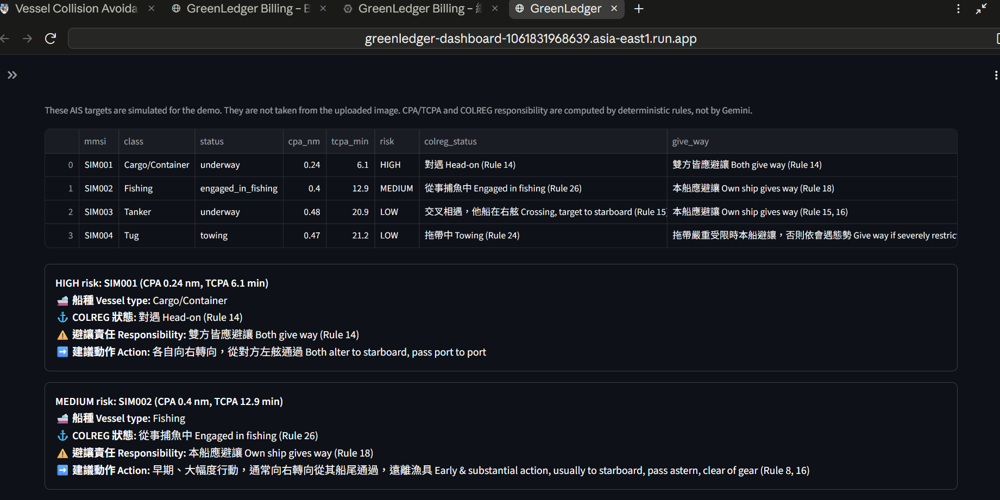
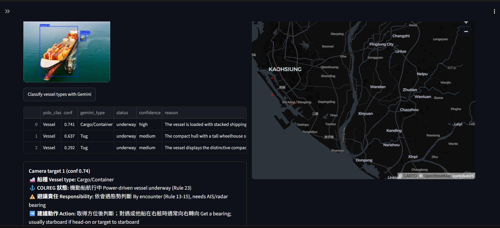
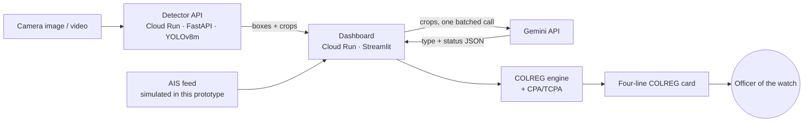
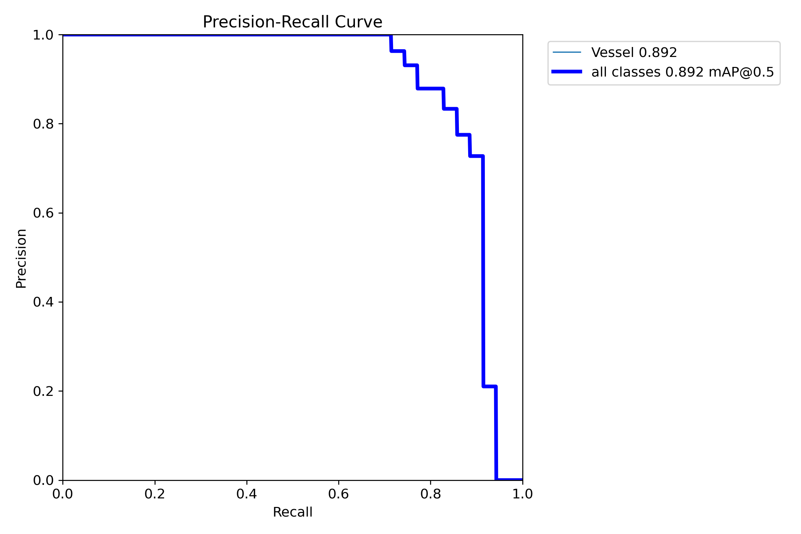
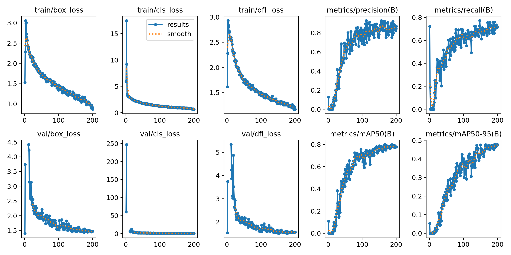

# GreenLedger SeaGuard

**AI sees the ship. COLREG decides who gives way. The officer makes the call.**

GreenLedger SeaGuard is a collision-avoidance decision-support system for ships and Vessel Traffic Service (VTS) centres. A fine-tuned YOLOv8 model finds vessels in camera frames, Gemini identifies the vessel type and its visible navigational status, and a deterministic COLREG rule engine tells the officer of the watch who must give way, under which rule, and what action to consider.

Built for the **Google Cloud AI Builder Cup 2026** · Theme: **Sustainability & Social Impact** · Team **GreenLedger SeaGuard** (Victor Chen, Min-Kun Hsiao)

| | |
|---|---|
| Live demo | https://greenledger-dashboard-1061831968639.asia-east1.run.app |
| Detector API | https://greenledger-detector-1061831968639.asia-east1.run.app/health |
| Demo video (3 min) | [link to be added] |
| Pitch deck (PDF) | [link to be added] |

> The first request after the service has been idle can take about 30 seconds while Cloud Run starts the detector. Later requests are fast.



---

## 1. The problem

Spotting a ship is easy. Knowing who must give way is the hard part.

- **Crowded water.** In the Taiwan Strait, busy ports, fishing fleets and offshore wind farm work vessels share the same sea.
- **Poor visibility.** Fog, rain and night shrink the time an officer has to read the situation and act early.
- **Easy to misread.** A vessel engaged in fishing, towing, or working on dynamic positioning (DP) has priority under the International Regulations for Preventing Collisions at Sea (COLREG), but that is not obvious from a glance.

Radar and AIS alarms today give a number, the closest point of approach (CPA). They do not say what COLREG requires. That gap is where GreenLedger SeaGuard works.

The project comes from the bridge: Victor served more than two years as Chief Mate on a DP2 vessel at an offshore wind farm in the Taiwan Strait, and the rule engine encodes how a watch officer actually reasons.

## 2. What it does

| Layer | Component | What happens |
|---|---|---|
| **1 · See** | Fine-tuned YOLOv8m on Cloud Run | Finds every vessel in a camera image or video, including fog and rain clips |
| **2 · Understand** | Gemini (multimodal, JSON output) | Names the vessel type (12 classes) and its visible status: nets out, towing, sails set, anchored |
| **3 · Judge** | COLREG engine + CPA/TCPA | Decides responsibility from AIS geometry and vessel status, and cites the rule |
| **4 · Decide** | The officer of the watch | Gets a four-line card and makes the final decision |

Example card for a simulated AIS target:

```
Vessel type     Fishing
COLREG status   Engaged in fishing (Rule 26)
Responsibility  Own ship gives way (Rule 18)
Action          Early & substantial action, usually to starboard, pass astern, clear of gear (Rule 8, 16)
```



## 3. Theme alignment: Sustainability & Social Impact

The theme asks for AI that addresses a meaningful environmental or societal challenge and enables more informed, sustainable decision-making. SeaGuard does that in three ways:

- **People.** Earlier, rule-based warnings protect fishermen, wind farm crews and seafarers. Small-boat crews are often the most exposed when a larger ship misreads the situation.
- **Ocean.** Fewer collisions mean fewer oil and fuel spills near ports, fishing grounds and offshore wind sites.
- **Fuel and emissions.** Late, last-second manoeuvres burn extra fuel. The dashboard includes a transparent, assumption-based estimate (for example, 6 avoided emergency manoeuvres × 300 L each ≈ 1,800 L per ship per month). These figures are illustrative assumptions, labelled as such in the app, to be replaced with fleet data.
- **Resilience.** The design keeps working when parts fail: no Gemini key, rate limits, or a cold detector all degrade to a clear message instead of a crash (see section 8).

## 4. How we use Google Cloud and Google AI

| Technology | Role in SeaGuard |
|---|---|
| **Cloud Run** (asia-east1) | Hosts both services: the detector API (FastAPI + PyTorch) and the dashboard (Streamlit). Scales per request and to zero when idle |
| **Cloud Build + Artifact Registry** | `gcloud run deploy --source` builds each container from its Dockerfile |
| **Gemini API** (`google-genai` SDK, Gemini Flash) | Multimodal vessel classification in **one batched request per image**, JSON-mode output; plain-language alert and sea-state summary |
| **Cloud Billing budgets** | Spending cap and alerts so the live demo stays within budget |
| **Colab (GPU)** | Fine-tuning YOLOv8m on our labelled dataset |

### Where AI is used, and where it deliberately is not

Safety-critical judgement must be repeatable and explainable, so we split the work:

| Task | Who does it | Why |
|---|---|---|
| Finding vessels in pixels | YOLOv8 (learned) | Perception is what deep learning does best |
| Naming vessel type and visible status | Gemini (learned) | Open-ended visual reasoning across 12 classes and 9 statuses |
| CPA / TCPA | Deterministic maths | Exact geometry, no model needed |
| Who gives way | **Deterministic COLREG engine** | Same input, same answer, every time; each answer cites a rule |
| Explaining the situation in words | Gemini, grounded | Gemini sees only the computed table and must repeat the engine's COLREG fields, never change them |
| The final decision | **Human** | COLREG Rule 2: responsibility stays with the crew |

Gemini output is treated as untrusted input: every label is validated against a closed list before the rule engine sees it (`agent/vessel_type.py`), and tests pin that behaviour (`tests/test_vessel_type.py`).

## 5. Architecture



```
greenledger-seaguard/
├── agent/
│   ├── colreg.py        # deterministic COLREG engine: encounter geometry + Rule 18 hierarchy
│   ├── risk.py          # CPA/TCPA, risk levels, grounded Gemini explanation with rule-based fallback
│   └── vessel_type.py   # batched Gemini classification, validated against closed label lists
├── dashboard/app.py     # Streamlit UI (Cloud Run service 2)
├── detector_api/        # FastAPI + YOLOv8 detector (Cloud Run service 1)
├── sim/simulate.py      # simulated AIS, telemetry and fog/rain augmentation (all labelled SIMULATED)
├── training/            # training metrics and curves for the deployed model
├── tests/               # 36 offline tests, run on every push by GitHub Actions
└── docs/                # model card, deployment and operations guide, images
```

## 6. Model results

YOLOv8m fine-tuned for one class, `Vessel`, at 512 px for 200 epochs. Metrics on the **held-out test split** (27 images, 35 vessels, never used for training or model selection):

| Model | mAP50 | Precision | Recall | F1 |
|---|---:|---:|---:|---:|
| v1 · 4 inconsistent classes | — | — | — | 34.6 |
| v2 · 1 class, 100 epochs | 85.4 | 96.0 | 69.0 | 80.3 |
| **v2 · 1 class, 200 epochs (deployed)** | **89.2** | **86.5** | **82.9** | **84.6** |

We favour **recall**: at sea a false alarm costs far less than a missed vessel. The dashboard defaults to a 0.20 confidence threshold for the same reason. The test set is small, so these numbers will move as data grows. Details are in [docs/MODEL_CARD.md](docs/MODEL_CARD.md).

| Precision–recall curve (test) | Training curves |
|---|---|
|  |  |

## 7. The COLREG engine

Own ship is assumed to be a power-driven vessel underway.

| Situation | Rules | Own ship |
|---|---|---|
| Head-on | 14 | Both alter to starboard |
| Crossing, target to starboard | 15, 16 | Give way, avoid crossing ahead |
| Crossing, target to port | 15, 17 | Stand on, watch closely |
| Overtaking / being overtaken | 13, 17 | Keep clear / stand on |
| Fishing, restricted in ability to manoeuvre, not under command, sailing | 18, 25–27 | Give way, early and substantial action |
| Constrained by her draught | 18(d), 28 | Do not impede |
| Towing | 24 | Never pass between tug and tow |
| At anchor | 30 | Keep clear |

A camera frame alone cannot show a target's heading, so for camera-only targets underway the engine says a bearing from AIS or radar is needed, instead of guessing.

## 8. Production readiness and reliability

| Concern | What we do |
|---|---|
| Cold starts | Services scale to zero to save cost. The dashboard retries the detector once with a 90 s timeout and tells the user if it is still waking up. For evaluation windows, `--min-instances 1` keeps it warm |
| Gemini rate limits | One batched request per image; automatic retry with back-off on 429 / 503; on failure the app shows a clear message and keeps working |
| No Gemini key | The app runs fully on rule-based text; nothing crashes |
| Untrusted model output | Gemini labels are clamped to closed lists before reaching the rule engine |
| Bad input | Unreadable images or videos give a message, not a stack trace |
| Health checks | `GET /health` on the detector reports the loaded model |
| Secrets | API keys live in Cloud Run environment variables (Secret Manager recommended), never in this repository; see `.env.example` |
| Cost control | Scale to zero, a budget cap with alerts, and CPU-only inference |
| Testing | 36 offline tests cover the COLREG engine, CPA/TCPA, risk levels and Gemini output validation; GitHub Actions runs them on every push |
| Safety boundary | Advisory display only. It never connects to steering or propulsion |

Deployment steps are in [docs/DEPLOYMENT.md](docs/DEPLOYMENT.md).

## 9. From prototype to real users

- **On the bridge:** camera, AIS and radar are read through the ship's existing NMEA 0183 / IEC 61162 outputs; detection runs on a small onboard GPU so it works offline; results appear on an advisory display beside ECDIS and radar.
- **Ship to shore:** only detections and alerts, not video, travel over a LEO satellite link, which keeps bandwidth and cost low.
- **At the VTS centre:** Cloud Run merges every reporting ship in an area into one COLREG picture for the VTS operator.
- **First users:** offshore wind farm operators, port and VTS authorities, ship operators and fishing associations in the Taiwan Strait.
- **Why it lasts:** COLREG has applied worldwide since 1977, so the same engine works in any sea; only the training data needs to be local.

## 10. Run it yourself

```bash
# 1. Detector (needs the fine-tuned weights, see detector_api/README.md)
cd detector_api
pip install -r requirements.txt
MODEL_PATH=best.pt KEEP_CLASSES=all uvicorn main:app --port 8080

# 2. Dashboard (from the repository root, in a second terminal)
pip install -r requirements.txt
cp .env.example .env            # add your own Gemini API key
export $(grep -v '^#' .env | xargs)
streamlit run dashboard/app.py

# 3. Tests
pip install pytest
python -m pytest -q
```

## 11. Honest limits

| Real and live | Simulated and labelled | Known limits |
|---|---|---|
| Fine-tuned detector, Gemini classification, COLREG and CPA/TCPA engine, two Cloud Run services | AIS targets, engine telemetry, fuel estimate | 268 labelled images; few offshore and DP vessels yet; one frame shows no heading; a low threshold can occasionally box the same vessel twice |

## 12. Roadmap

1. **Data:** label the 1,107 images waiting in our Roboflow project; add offshore, DP, night and fog scenes.
2. **Sensor fusion:** a live AIS feed and radar (ARPA) targets matched to camera detections for bearing and heading.
3. **Ship to shore:** LEO satellite links so a shore VTS sees the same COLREG picture as the bridge.
4. **Pilots and research:** port and VTS pilots in Taiwan and Singapore; PhD research on human–AI collaboration in collision avoidance.

## 13. Team

- **Victor Chen**: Chief Mate (DP2, offshore wind), M.S. Information & Electrical Engineering, Feng Chia University. victor.cheng.wei@gmail.com
- **Min-Kun Hsiao**: [role]

## License

MIT. See [LICENSE](LICENSE).

*Decision support only. GreenLedger SeaGuard does not replace a proper lookout (COLREG Rule 5), safe speed (Rule 7) or the judgement of the officer of the watch (Rule 2).*
